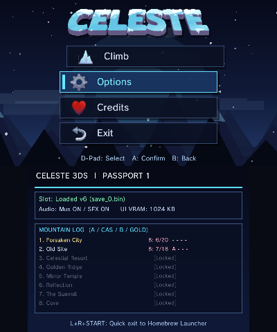
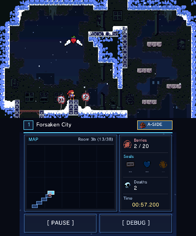
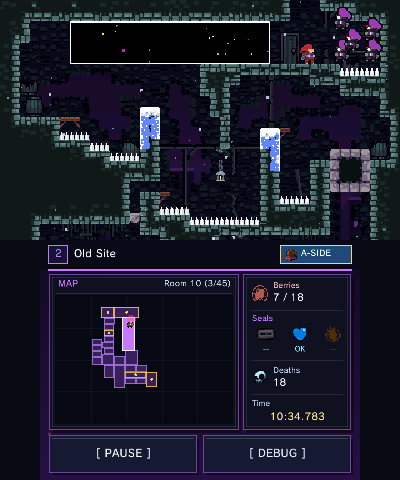
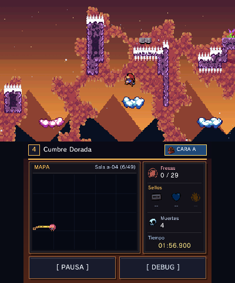

# Celeste 3DS

> A native C++17 engine port of *Celeste* for the **Nintendo 3DS** family (**Old 3DS / Old 2DS** & **New 3DS / New 2DS XL**), by **alberdura**.

[English](#english) · [Español](#español)

---

> **LEGAL NOTICE / AVISO LEGAL**
>
> **EN:** This repository contains **zero** copyrighted game assets, maps, textures, audio, or source files from *Celeste*. You **must own a legal PC copy of Celeste** (Steam, itch.io, or Epic Games Store) and provide your own `Content/` folder on your SD card.
>
> **ES:** Este repositorio **no incluye** ningún archivo original, mapa, gráfico, audio ni texto de *Celeste*. Necesitas tu **propia copia legal de Celeste de PC** (Steam, itch.io o Epic Games Store) y aportar tu carpeta `Content/` en la tarjeta SD.

---

## Screenshots / Capturas

| Main Menu / Menú Principal | Chapter 1 / Capítulo 1 |
| :---: | :---: |
|  |  |
| **Chapter 2 / Capítulo 2** | **Chapter 4 / Capítulo 4** |
|  |  |

---

## English

> I don't recommend anyone to experience Celeste for the first time through this port. It's more of a way for people who already love the game to enjoy it on a different platform. Celeste is one of my favourite games, and the 3DS is my favourite console. I simply wanted to bring the two together.

### Highlights
- **Complete Story + B-Sides:** Prologue + Chapters 1–8 (A-Side & B-Side remixes), Assist Mode, 3 Save Slots, and live **English / Español** support.
- **Sharp Hybrid Rendering:** Pixel-exact **320×180 (60 FPS)** gameplay scaled cleanly to **400×240** (`GPU_NEAREST`), with native **400×240 / 320×240** UI, portraits, and bottom-screen map/stats.
- **On-Console Asset Compiler:** No PC conversion scripts needed — copy `Content/` once and the 3DS compiles everything natively with file-by-file **Safe Resume**.

### Installation (3 Steps)
1. **Download and install** `v1.0.3` in either format from **[Releases](https://github.com/alberdura/Celeste3DS-releases/releases)**:
   - **`.3dsx` (Homebrew Launcher):** Copy `Celeste3DS.3dsx` to `sdmc:/3ds/celeste3ds/Celeste3DS.3dsx`.
   - **`.cia` (HOME Menu):** Install `Celeste3DS.cia` with **FBI**.
2. **Copy your PC `Content/` folder** from your legal copy of *Celeste* onto your SD card at:
   ```text
   sdmc:/3ds/celeste3ds/Content/
   ```
3. **Launch Celeste 3DS** on your console:
   - On first boot, the built-in installer automatically compiles dialogs, maps, sprites, and audio into `sdmc:/3ds/celeste3ds/cache/`.
   - This takes **~20–35 minutes on Old 3DS** (faster on New 3DS). If interrupted or powered off, simply reopen the app and it resumes safely from the last completed file.
   - Every boot after that starts **instantly**.

*(Tip: Make sure `sdmc:/3ds/dspfirm.cdc` exists on your SD card for NDSP sound and music, and keep ~250 MB free alongside `Content/`.)*

### Controls
| Nintendo 3DS | Action |
|---|---|
| D-Pad / Circle Pad | Move / Aim Dash |
| **A** | Jump / Confirm |
| **B** | Dash / Back |
| **Y** or **L / R** | Grab / Climb |
| **START** | Pause / Menu |
| **Touch Screen** | Live Minimap, `[ PAUSE ]` & `[ DEBUG ]` |
| **L + R + START** | Quick Exit to Homebrew Launcher |

---

## Español

> No recomiendo a nadie jugar a Celeste por primera vez a través de este port. Es más bien una forma de que quienes ya aman el juego puedan disfrutarlo en una plataforma diferente. Celeste es uno de mis juegos favoritos y la 3DS es mi consola favorita; simplemente quería unir ambas cosas.

### Características
- **Historia completa + Caras B:** Prólogo + Capítulos 1–8 (Caras A y B), Modo Asistencia, 3 ranuras de guardado e interfaz/diálogos **bilingües (Español / English)**.
- **Renderizado Híbrido Nítido:** Juego exacto a **320×180 (60 FPS)** escalado con `GPU_NEAREST` a **400×240**, con textos, retratos, menús y diario táctil en resolución nativa.
- **Compilador Nativo en 3DS:** Sin scripts externos de PC — copia `Content/` una vez y tu 3DS compila todos los recursos con **reanudación segura** archivo por archivo.

### Instalación en 3 Pasos
1. **Descarga e instala** la versión `v1.0.3` en el formato que prefieras desde **[Releases](https://github.com/alberdura/Celeste3DS-releases/releases)**:
   - **`.3dsx` (Homebrew Launcher):** Copia `Celeste3DS.3dsx` en `sdmc:/3ds/celeste3ds/Celeste3DS.3dsx`.
   - **`.cia` (Menú HOME):** Instala `Celeste3DS.cia` con **FBI**.
2. **Copia la carpeta `Content/`** de tu copia original de *Celeste* en PC dentro de tu tarjeta SD:
   ```text
   sdmc:/3ds/celeste3ds/Content/
   ```
3. **Abre Celeste 3DS** en tu consola:
   - En el primer arranque, la propia 3DS compilará automáticamente los diálogos, mapas, gráficos y audio en `sdmc:/3ds/celeste3ds/cache/`.
   - El proceso tarda unos **20–35 minutos en Old 3DS** (menos en New 3DS). Si se apaga o se interrumpe a mitad, al volver a abrirlo continuará desde el último archivo completado.
   - A partir de ahí, el juego arrancará **al instante**.

*(Nota: Asegúrate de tener `sdmc:/3ds/dspfirm.cdc` en la SD para escuchar música y efectos vía NDSP, y unos ~250 MB libres adicionales para la caché).*

### Controles
| Nintendo 3DS | Acción |
|---|---|
| Cruceta / Botón Deslizante | Moverse / Apuntar Dash |
| **A** | Saltar / Aceptar |
| **B** | Dash / Volver |
| **Y** o **L / R** | Agarrarse / Escalar |
| **START** | Pausa / Menú |
| **Pantalla Táctil** | Mapa de sala, `[ PAUSA ]` y `[ DEBUG ]` |
| **L + R + START** | Salir rápido al Homebrew Launcher |

---

## Credits / Créditos
- **Celeste 3DS** port by **alberdura**
- Original *Celeste* by **Maddy Makes Games & Extremely OK Games (EXOK)**
- Built with `devkitARM`, `libctru`, `citro2d`, `citro3d`, `stb_vorbis`
